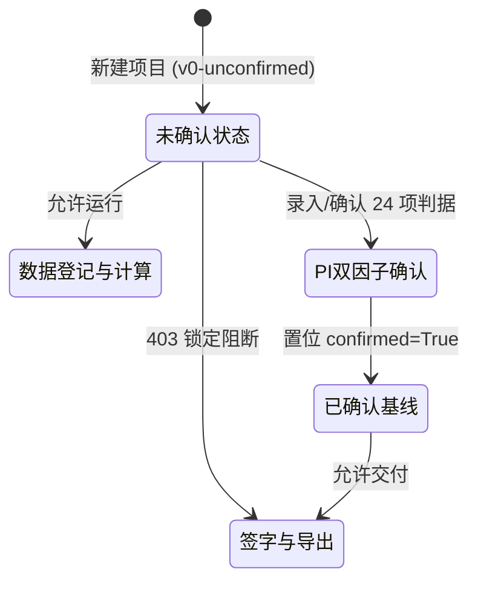
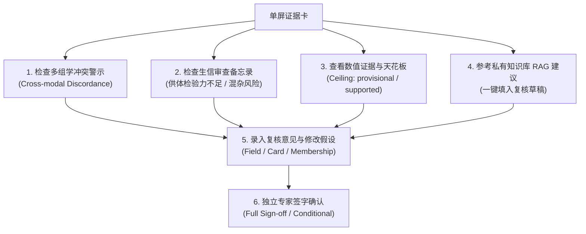

# BioAdapt-Core 平台用户使用手册

> **版本**：v2.0 (Reference Deployment)  
> **适用对象**：项目负责人（PI）、生物信息分析师（Analyst）、领域审查专家（Domain Expert）、合规与审计人员（Compliance/Audit）

---

## 目录

- [1. 平台概述与核心理念](#1-平台概述与核心理念)
- [2. 快速起步与工作台访问](#2-快速起步与工作台访问)
- [3. 身份角色与权限机制](#3-身份角色与权限机制)
- [4. 端到端分析全流程指引](#4-端到端分析全流程指引)
  - [4.1 步骤一：创建项目与隐私分级](#41-步骤一创建项目与隐私分级)
  - [4.2 步骤二：阶段 0 判据基线确认（解除结论锁定）](#42-步骤二阶段-0-判据基线确认解除结论锁定)
  - [4.3 步骤三：数据资产登记与上传](#43-步骤三数据资产登记与上传)
  - [4.4 步骤四：私有知识库管理与 RAG 检索](#44-步骤四私有知识库管理与-rag-检索)
  - [4.5 步骤五：分析计划（Plan）编制与锁定](#45-步骤五分析计划plan编制与锁定)
  - [4.6 步骤六：启动 Run 并触发进程内执行](#46-步骤六启动-run-并触发进程内执行)
  - [4.7 步骤七：审批流处理与 Ad-hoc 工具授权](#47-步骤七审批流处理与-ad-hoc-工具授权)
  - [4.8 步骤八：专家复核队列处理](#48-步骤八专家复核队列处理)
  - [4.9 步骤九：单屏证据卡深度审查、RAG 采纳与签字](#49-步骤九单屏证据卡深度审查rag-采纳与签字)
  - [4.10 步骤十：跨轮对齐历史追踪](#410-步骤十跨轮对齐历史追踪)
  - [4.11 步骤十一：结论与成果导出](#411-步骤十一结论与成果导出)
- [5. 核心角色操作手册（Playbooks）](#5-核心角色操作手册playbooks)
- [6. 常见问题排查（FAQ）](#6-常见问题排查faq)

---

## 1. 平台概述与核心理念

BioAdapt-Core 是一套专为高灵敏度临床科研与生物医药发现设计的 **AI 辅助单细胞多组学分析平台**。不同于传统黑盒生信流程或端到端生成式大模型，BioAdapt-Core 建立在以下核心原则之上：


1. **判据先于人（§1.5）**：在正式分析前必须冻结 24 个质量判据，防止“为迎合预期假设而动态调整阈值”。
2. **证据天花板与数值溯源（§7.x）**：任何单细胞亚型与候选结论都由具体计算指标（如 DE FDR、Coverage 比值、批次稳定性）锚定可达到的“结论天花板（Ceiling）”，专家或大模型均不能凌驾于原始数据质量之上。
3. **职责分离（Separation of Duties, SoD）**：
   - 申请人不得自行批准自己的审批门；
   - 计划或运行作者不得对自己的结论执行最终签字确认；
   - 服务账号（Agent）仅具备数据和模型调度权，禁止执行任何最终审批与签字决策。
4. **多组学与私有知识库双向辅助**：平台内置零外部依赖的私有文献/知识库 RAG 引擎，并提供跨组学表达与染色质可及性不一致性（Cross-modal Discordance）的实时警示。

---

## 2. 快速起步与工作台访问

### 2.1 启动后端与前端栈

本系统采用轻量化本地参考架构：

**终端 A：启动 API 与种子数据服务**
```bash
cd /Users/yifanwang/workspace/BioAdapt-Core
.venv/bin/python scripts/serve_workbench.py
```
> 服务将在 `http://127.0.0.1:8000` 启动，并自动生成种子项目 `prj_scrnaseq`、参考运行 `run_scrnaseq_01`，同时写好第一把登录密钥 `.workbench/admin.pem`（`platform_admin`）并登记进身份目录。五个角色的登录凭据仍然一键可得：工作台的身份预设与 `GET /v1/development/tokens` 都会发放（仅参考模式），真实部署怎么用密钥文件换短期 token 见 `README.md` 6.1.1。

**终端 B：启动项目工作台前端**
```bash
cd /Users/yifanwang/workspace/BioAdapt-Core/apps/web
npm run dev -- -p 3100
```
> 打开浏览器访问 `http://localhost:3100`。

---

## 3. 身份角色与权限机制

右上角 **Acting as** 面板用于模拟当前操作人员身份。系统内置标准多角色协作矩阵与**单人全流程模式（Solo Mode）**：

| 身份代号 | 角色名（Role） | 典型人员 | 核心权能与操作职责 |
| --- | --- | --- | --- |
| **`solo`** | `solo_operator` (复合) | 单人研究员 / 演示评估人员 | **单人全流程演练模式**：兼具 PI、Analyst、Expert 全套权能，豁免 SoD 限制，支持自建、自批、自审与自主签字 |
| `pi` | `principal_investigator` | 课题组负责人 / PI | 确认阶段 0 判据基线、批准计划/升级门、发放 Ad-hoc 工具执行凭证 |
| `analyst` | `analyst` | 生信分析师 | 登记数据、编制分析计划、发起 Run 与执行、录入候选簇初审标签 |
| `expert` | `domain_expert` | 免疫/肿瘤领域专家 | 处理复核队列、单屏审查证据卡、采纳 RAG 建议、给出 Full/Conditional 签字 |
| `expert2` | `domain_expert` | 独立复核专家 | 用于满足“作者不得自签”时的独立第三方专家签字或撤签操作 |
| `engine` | `service_agent` | 系统自动化服务账号 | 仅能执行后台读取与 DAG 调度，**禁止**参与审批与签字 |

### 3.1 单人全流程模式（Solo Mode）特别说明

为了方便单人开发者、算法评估人员或现场演示在不打断思路的情况下快速跑通从立项到签字交付的全流程，系统专门设计了 **单人模式（Solo Mode）**：

- **顶栏一键切换与激活**：在顶部全局导航栏右上角设有常驻的 `⚡ 单人模式 (Solo Mode)` 按钮。无论当前处于哪个页面，均可一键激活/退出单人全流程模式，激活后导航栏右侧将亮起绿色 `⚡ 单人模式 (已激活)` 徽章。
- **首页一键单人快速通道**：在系统首页（Start Page）顶部设有“⚡ 单人模式快速通道”专属面板，点击 `🚀 以单人模式一键进入演示项目` 即可自动装载单人凭据、打开 `prj_scrnaseq` 并跳转进入。
- **免除职责分离（SoD）阻断**：
  1. **审批门自提自批**：单一操作人提出的 `escalation` 或 `node` 审批门，可由同一用户立即点击 Approve 放行，无需换登 PI 账号；
  2. **Ad-hoc 工具自发自用**：申请引入自研算法后，同一人可直接在界面一键签发 CAS 一次性台账执行凭据；
  3. **证据卡自主终审与签字**：作为分析执行人和假设起草者，单人模式下允许专家直接对本卡执行 Full/Conditional 签字背书，解除“作者不得自签”的阻断。
- **全流程页面无缝联动提示**：在审批收件箱、证据卡签字、工作流下一步规划等各关键页面，均会自动展示单人模式状态与豁免提醒，操作人始终清晰知晓当前的权限与放行状态。
- **安全与审计边界**：单人模式是受控的，后端所有的审计日志均会明确记录 `solo_mode: true` 标记，确保演练行为与生产严格多角色模式具有不可混淆的可审计边界。

### 3.2 界面语言切换
在顶部导航栏右上角提供 **中文 / English** 一键切换按钮，全局字典覆盖业务术语、审查备忘录及门禁文案。

### 3.3 一个真人怎么获得自己的登录身份
本地参考栈里，身份面板的一键预设与 `GET /v1/development/tokens` 就够用。真实部署不给"谁都能领一个角色"的口子，改成像 SSH 那样用密钥文件（细节见 `README.md` 6.1.1）：

1. 使用者在自己机器上生成密钥，把打印出来的 `.pub` 文本发给管理员，私钥不出机器：
   `.venv/bin/python scripts/bioadapt_login.py keygen --out ~/.ssh/bioadapt.pem --subject user_pi_02`
2. 管理员打开 `/keys`（导航栏"登录密钥"），整份粘贴 `.pub`，勾选角色、项目范围与后果项（是否有二次因子、是否单人模式、是人还是流水线），点「授权这把密钥」。`kid` 与指纹由公钥自动推导，不需要抄任何 ID。
3. 使用者登录，得到一个默认 15 分钟的 access token，贴进工作台右上角的 **Acting as** 面板：
   `.venv/bin/python scripts/bioadapt_login.py login --key ~/.ssh/bioadapt.pem`

之后的每一次操作，权限都由 API 从身份目录那一行重新读，不是从密钥里读；管理员在 `/keys` 吊销后，这把私钥下一次换票就被拒。吊销对那一对密钥是终局的（同一份公钥不能登记第二次），所以"重新给这个人放行"是让他再 `keygen` 一份新的公钥登记进去。忘记或丢了密钥文件同理：登记新的公钥、吊销旧行，不影响项目数据。

---

## 4. 端到端分析全流程指引

### 4.1 步骤一：创建项目与隐私分级

1. 进入工作台首页 `/`，点击 **“+ New Project（新建项目）”**。
2. 填写项目标识（`project_id`，如 `prj_oncology_01`）与研究目标（`study_goal`）。
3. 选择 **隐私安全分级（`privacy_tier`）**：
   - `public`：公开数据，允许模型跨域协同。
   - `restricted`：限制受控，默认屏蔽原始细胞外发。
   - `strict_local`：严苛本地模式，**全局阻断任何云端大模型调用与数据导出**。
   - `hgr_controlled`：人类遗传资源受控模式，出境须走白名单模板审核。
4. 设定批次分析目标与每周复核负荷预算（`review_load_budget_hours_per_week`）。
5. 点击提交完成立项。

---

### 4.2 步骤二：阶段 0 判据基线确认（解除结论锁定）

> [!IMPORTANT]
> **关键机制**：新建项目默认处于 `v0-unconfirmed` 未确认状态。在此状态下，数据登记、计算 DAG 与候选集起草均可正常进行，但**最终签字（Sign-off）和成果导出（Export）将被系统 403 强制阻断**。



#### 工作台操作步骤：
1. 确保右上角身份为 **`pi`**。
2. 进入项目主页 `/projects/{projectId}`，在上方可以看到高亮的 **“判据基线状态”** 提示面板。
3. 点击 **“查看 / 确认阶段 0 判据基线”** 展开 24 个质量判据清单（覆盖稀有亚群最小细胞数、覆盖率阈值、稳定性 Jaccard 指数、拟假 bulk DE FDR 最大值等）。
4. 核对数值无误后，输入确认理由（Rationale，如“基于历史 PBMC 队列基线标定”），并确认 MFA 二次认证标识。
5. 点击 **“确认并固化基线（Confirm Baseline）”**。
6. 界面状态将刷新为绿色的 **“阶段 1 已确认”** 徽章，签字与导出出口即刻解锁。

---

### 4.3 步骤三：数据资产登记与上传

1. 进入项目导航栏的 **“Data（数据登记）”** 屏（`/projects/{id}/data`）。
2. **单细胞原始文件转换（推荐）**：
   - 若您持有 `.h5ad` 原始矩阵文件，使用内置转换脚本将其转换为平台规范资产：
     ```bash
     .venv/bin/python scripts/convert_h5ad.py \
       --input your_data.h5ad \
       --output-dir ./converted_assets/ \
       --project-id prj_scrnaseq \
       --organism "Homo sapiens" \
       --tissue "PBMC"
     ```
   - 脚本将生成标准化的 `as_xxxx.json` 与 `as_xxxx.manifest.json` 元数据。
3. **批量拖拽登记**：
   - 将资产文件拖入上传区域，浏览器端将自动计算不可伪造的 SHA-256 校验和与内容指纹。
   - 确认元数据后完成登记，资产进入受管清单。

---

### 4.4 步骤四：私有知识库管理与 RAG 检索

系统提供完全运行在本地、不依赖外部第三方的单细胞与免疫学生物文献知识库：

1. 进入 **“Knowledge（私有知识库）”** 屏（`/projects/{id}/knowledge`）。
2. **导入参考文献与项目资料**：
   - 支持拖拽上传 `.md`、`.pdf`、`.docx`、`.txt` 等格式的文献或实验室报告。
   - 系统将自动进行结构化分块（Chunking）与零依赖向量化构建。
3. **语义检索测试**：
   - 在页面下方的检索框中输入查询（例如：“*CD14+ monocytes in acute inflammation*”）。
   - 点击查询即可查看本地知识库命中的相关文本切片与文献引用来源。
4. **标记基因亚型推断测试**：
   - 输入特征 Marker 列表（如 `CD3D, CD3E, TRAC, IL7R`），指定组织（如 `blood`）。
   - 系统返回推荐的可能细胞亚型、匹配证据及推荐置信度。

---

### 4.5 步骤五：分析计划（Plan）编制与锁定

1. 进入 **“Plans（分析计划）”** 屏（`/projects/{id}/plans`）。
2. 录入或编辑计划 JSON 规范，关键要素包括：
   - **DAG 节点（Nodes）**：定义 `qc`、`normalize`、`feature_selection`、`embedding`、`neighbors`、`clustering`、`markers`、`pseudobulk_de` 等计算步骤与所绑定的工具。
   - **三轴预算配额（Loop Budget）**：
     - `max_compute_minutes`（算力分钟上限）
     - `max_token_cost_usd`（模型预算上限）
     - `max_iterations`（迭代循环次数上限）
   - **必选停止条件（Stop Conditions）**：必须包含 `input_schema_invalid`、`critical_quality_failure`、`unresolved_design_confounding`。
3. 点击提交，系统进行服务端全字段校验，并生成固化的 `plan_sha256` 摘要。

---

### 4.6 步骤六：启动 Run 并触发进程内执行

1. 进入项目主页，在 **“Launch a Run”** 模块选择已通过验证的 Plan。
2. 绑定输入资产 ID（`input_asset_ids`）。
3. 工具快照字段系统已自动填入当前环境的稳定参考快照哈希。
4. 点击启动，Run 进入初始状态。
5. **Phase 2 进程内计算执行**：
   - 进入该 Run 的详情页（`/projects/{id}/runs/{runId}`）。
   - 查看运行状态机，此时处于待运行状态。
   - 点击右上角显著的 **“启动执行（Execute In-Process）”** 按钮。
   - 系统将在后端进程内完整执行 11 节点 DAG 计算流，自动执行质控过滤、高变基因筛选、PCA 降维、确定性聚类与拟假 bulk 差异表达分析。
   - 计算完成后，系统自动识别出候选亚群集合（C1-C3），并自动为各聚类起草生成证据卡！

---

### 4.7 步骤七：审批流处理与 Ad-hoc 工具授权

#### 4.7.1 常规审批门决策
1. 进入 **“Approvals（审批收件箱）”** 屏（`/projects/{id}/approvals`）。
2. 查看当前分配给您的审批门（如高危聚类节点审批、计划变更或升级门）。
3. 切换为对应责任人（例如 `pi`）点击 **Approve（批准）** 或 **Reject（拒绝）**，并录入决策理由。
4. 若需移交责任，可使用 **Delegate（委托）** 转移给其他负责人。

#### 4.7.2 Ad-hoc 自研工具一次性安全授权（§9.6 闭环）
当分析师需引入外部定制算法（如实验性聚类或特定评分工具）时：
1. **Analyst 申请**：在 Plan 中声明 `project_adhoc` 节点，并向 PI 申请一扇 `adhoc_tool` 审批门。
2. **PI 答复**：PI 在审批页点击决策，批准引入该工具。
3. **PI 一键发放授权（Ad-hoc Grant）**：
   - 在该已批准的审批门下方，将展开 **“发放一次性工具授权（Ad-hoc Grant）”** 面板。
   - 填写工具名称、版本、资源限制（核数、内存、超时分钟，不可超出平台安全笼子）。
   - 确认发放后，系统向底层的持久 CAS 台账（`tool_grant` 表）写入一次性记录。
   - 引擎在执行该节点前将执行原子抢占，保证“用完即销毁，防带外越权”。

---

### 4.8 步骤八：专家复核队列处理

1. 领域专家切换为 **`expert`** 身份，进入 **“Queue（专家复核队列）”** 屏（`/projects/{id}/queue`）。
2. **队列排序逻辑**：系统依据双盲优先级模型进行智能排序：
   $$\text{Priority Score} = \text{Impact}(0\sim3) \times \text{Uncertainty}(0\sim3) + \text{Client Ask}(0/2)$$
3. **查看排序依据（Reasons）**：表格中清晰列出为何排在当前位置（例如：“稀有亚群但跨供体一致性低”、“存在 1 条相抵触的负向证据”）。
4. 点击某一候选行，进入专属单屏证据卡进行深入复核。

---

### 4.9 步骤九：单屏证据卡深度审查、RAG 采纳与签字

单屏证据卡（`/projects/{id}/candidates/{candidateId}`）是结论判定的终审战场：



#### 关键审查区域：
1. **跨模态冲突警示条**：若多组学分析中 RNA 表达与染色质开放性严重偏离，顶部将呈现黄色警示，提醒专家不可草率判定。
2. **生信审查备忘录（Reviewer Memo）**：
   - 警示供体数量不足（如 $N \le 2$ 时的伪重复假象）。
   - 警示潜在批次混杂风险。
3. **天花板读数（Ceiling）**：明确展示此卡当前数据支撑的最高可能等级（如缺少独立验证集时，天花板固定为 `provisional`）。
4. **私有知识库内联建议**：
   - 页面右侧根据候选簇的高表达 Marker 自动展示知识库 RAG 匹配结果。
   - 点击 **“填入复核草稿（Fill review draft）”**，可将建议的细胞类型和依据一键填入下方的复核表单中。
5. **提交复核（Review）**：
   - 完善假说类型（`hypothesis_type`）、细胞标签（`candidate_label`）与 Cell Ontology 编号。
   - 提交复核意见，结论状态推进至天花板允许的级别。
6. **最终签字（Sign-off）**：
   - 确认非该卡原起草者后，点击 **Full Sign-off**（正式背书）或 **Conditional**（附条件通过）。
   - 卡片结论正式固化。

---

### 4.10 步骤十：跨轮对齐历史追踪

进入 **“Alignment（跨轮对齐）”** 屏（`/projects/{id}/candidates/{candidateId}/alignment`）：
- 查看当前候选亚群在多轮迭代计算中的 Jaccard 相似度追踪曲线。
- 确认该亚群是真正稳定存在的生物学状态，而非特定超参数下的聚类假象。

---

### 4.11 步骤十一：结论与成果导出

1. 进入 **“Exports（导出）”** 屏（`/projects/{id}/exports`）。
2. 选择导出类别：
   - `tables`：全量差异表达与候选特征表格。
   - `figures`：高保真聚类分布与标记物图表。
   - `code_bundle`：可完整复现本次分析的代码环境与脚本包。
   - `delivery_zip`：面向客户交付的标准化成果压缩归档包。
3. 点击发起导出。系统将自动生成具备完整审计追溯链路的导出记录。

---

## 5. 核心角色操作手册（Playbooks）

### 剧本 A：课题负责人（PI）日常作业
- **第一天**：项目立项，检查实验设计矩阵，在 `/projects/{id}` 确认阶段 0 的 24 个判据基线，输入 MFA。
- **运行期**：接收分析师的提权申请，在 `/approvals` 页面审阅非常规操作，一键发放受控 Ad-hoc 授权。
- **收尾期**：检查专家签字完成度，审定导出报告并归档。

### 剧本 B：生信分析师（Analyst）分析闭环
- **数据准备**：使用 `convert_h5ad.py` 本地转换测试数据，拖拽上传至平台登记资产。
- **计划与执行**：配置 Plan JSON，设定三轴算力预算；在 Run 详情页点击 **“Execute In-Process”** 跑通 11 节点全流程。
- **初筛与起草**：检查生成的聚类与差异表达列表，对候选簇撰写初步假设草稿。

### 剧本 C：临床/生物学领域专家（Domain Expert）深度评审
- **审阅队列**：进入 `/queue`，按影响度和不确定性自上而下逐一审核。
- **卡片研判**：进入单屏证据卡，核对跨模态一致性、审查备忘录警示与 Coverage 分布。
- **采纳建议与背书**：参考本地 RAG 建议一键填入复核意见，填写 Cell Ontology 术语，签署专家终审意见。

---

## 6. 常见问题排查（FAQ）

### Q1：为什么在证据卡点击签字（Sign-off）或导出时提示 403 错误？
> **原因**：当前项目的阶段 0 判据基线未被确认（`confirmed: false`）。  
> **处置方法**：切换至 **`pi`** 身份，访问项目主页 `/projects/{id}`，在“判据基线状态”面板中点击确认 24 项指标并提交 MFA 理由即可放行。

### Q2：为什么我在审批收件箱点击 Approve，系统报 `approval:decide: the subject that requested a gate may not open it`？
> **原因**：违反了职责分离（SoD）安全红线。申请该审批门的人员与当前批准人是同一用户。  
> **处置方法**：右上角切换至被指派的问责人员（如从 `analyst` 切换到 `pi`）再行审批。

### Q3：为什么专家执行了 Full Sign-off 签字，卡片状态仍然是 `provisional` 而没有变成 `supported`？
> **原因**：触碰到了证据天花板（Ceiling）。  
> **处置方法**：在证据卡上方查看 `gate_reasons` 读数。如果数据缺少独立重复队列（Confirmation Partition）验证或关键稳定性指标未达标，门禁机制会自动将天花板封顶在 `provisional`，这是保障结论科学严肃性的预期行为。

### Q4：为什么发起 Run 后一直处于 `CREATED` 状态？
> **原因**：本地参考部署默认未常驻分布式异步任务 Worker。  
> **处置方法**：点击进入该 Run 详情页，点击右上角的 **“启动执行（Execute In-Process）”** 按钮即可在单机进程内即时触发计算。

### Q5：界面报 500 编译错误或缓存异常？
> **处置方法**：运行以下命令清理 Next.js 临时缓存后重启即可：
> ```bash
> rm -rf apps/web/.next
> cd apps/web && npm run dev -- -p 3100
> ```
